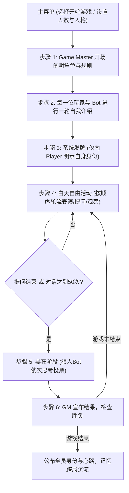

# 单机模拟多人“狼人杀”游戏设计文档 (design_gemini.md)

---

## 1. 概述 (Overview)

这是一个单机运行、模拟多人的“狼人杀”社交推理游戏：
- **AI 驱动**：所有的 Bot 均由本地大语言模型（Ollama）控制，每个 Bot 拥有自己独立的 Personality。
- **界面形式**：**对话框选择的界面**，纯 HTML5 实现，由静态内容服务器（Static Content Server，如 `python -m http.server`）托管。
- **交互核心**：以对话框展示剧情与事件流，玩家通过对话框菜单选项进行选择（非花哨复杂的复杂图形界面，专注对话与选择推理）。

---

## 2. 游戏菜单 (Game Menu)

进入游戏主界面为一个清晰的**对话框菜单选择界面**，提供以下选项：

```text
┌──────────────────────────────────────────────────────────┐
│                   【 狼 人 杀 】                          │
│                                                          │
│   请选择操作：                                           │
│   [1] 开始游戏 (Start Game)                              │
│   [2] 生成 Personality 文件 (Create Personality)          │
│   [3] 删除 Personality 文件 (Delete Personality)          │
│   [4] 退出 (Exit)                                        │
└──────────────────────────────────────────────────────────┘
```

1. **生成 Personality 文件**：允许用户创建一个新的 AI personality markdown 文件（输入 First Name，填写或由 AI 协助生成性格内容）。
2. **删除 Personality 文件**：列出当前所有的 personality 文件供玩家选择删除。
3. **开始游戏**：
   - 校验：必须至少有足够的 personality 文件；
   - 玩家选择本局人数（如 6 人、8 人）及参与对局的 personality 文件（为每个 Bot 槽位指定不同的 personality 文件，保证每个 Bot 性格互不相同）。
4. **退出**。

---

## 3. AI Personality 文件 (Personality File)

Personality 文件是标准的 **Markdown 文件 (`.md`)**，以某一个 **First Name** 命名（保存在 `./personalities/{FirstName}.md`，例如 `Alice.md`、`Bob.md`、`Charlie.md`、`David.md` 等）。

文件内容直接采用结构清晰的 Markdown 格式，便于直接作为自然语言 Prompt 注入本地 LLM：

```markdown
# Personality: Alice

## 基础特质
- 名字: Alice
- 话量倾向: 偏少，安静且谨慎
- 说话语气 (Tone): 语气轻柔温和，很少主动打断他人，被提问时会先短暂停顿再认真回答。

## 习惯小动作与表情 (Habitual Gestures & Expressions)
- 思考时喜欢用食指轻轻点自己的下巴。
- 说话时偶尔会低头避开正面视线，双手不自觉地整理衣角。
- 感到紧张或被怀疑时，会反复端起水杯但并不喝水。

## 社交与游戏风格 (Game Style)
- 信任倾向: 慢热，重视事实逻辑，对激进带节奏的人保持怀疑。
- 搭话方式: 喜欢用礼貌的疑问句向别人请教看法，例如：“我也在思考这点，你觉得他刚才那句话合理吗？”
```

---

## 4. 完整的游戏流程 (Game Flow)



### 步骤 1：Game Master 开场阐明角色与规则
Game Master 在对话框中简略说明本局板子配置：
> *“欢迎来到狼人杀。本局为 8 人局：狼人 2 名、预言家 1 名、女巫 1 名、村民 4 名。狼人目标是消灭好人，好人目标是找出并消灭所有狼人。天黑前所有人先互相认识。”*

### 步骤 2：自我介绍破冰环节 (Self-Introduction)
* 每一个玩家（包括人类玩家和各个 Bot）按照座位顺序**做一轮自我介绍**。
* 每个 Bot 根据自己的 Personality Markdown 文件，以符合其性格、语气和小动作的方式发言。
* 人类玩家可以在对话框中输入自己的介绍，或者选择默认发言。
* 这一轮让玩家和各个 Bot 建立对彼此的第一印象。

### 步骤 3：发放秘密身份
* 自我介绍结束后，系统发给每个 player 和 bot 它的身份。
* **只有 player 自己的真实身份会明示给 player**；Bot 的真实身份秘密存入其自身的内存中，外界不可见。

### 步骤 4：白天“自由活动”时间 (Day Free Phase)
每一轮白天是自由活动时间，存活玩家**按座位顺序轮流行动**：
1. **轮到 Bot 行动时**：
   - Bot 必须**先思考**（CoT），然后根据自己的 personality 选择动作：
     - 可以是一个表情或小动作（如叹气、敲桌子、若有所思等）；
     - 可以向玩家或其他 Bot 提问；
     - 可以发表一段观点或指控；
     - 也可以选择暂时保持安静。
   - 如果 Bot 提问了另一名角色，被提问者在对话框中立即进行应答。
2. **轮到人类玩家行动时**：
   - 界面弹出对话框选项供玩家选择：
     - **[选项 1] 观察**：选择一名存活 Bot，观察该 Bot 当前的行为、表情与小动作；
     - **[选项 2] 提问**：选择一名存活 Bot 并输入你想质询的问题，目标 Bot 会立刻根据其性格与当前局势作答；
     - **[选项 3] 发言**：在对话框中发表你对当前局势的看法；
     - **[选项 4] 结束发言 (Pass)**。
3. **进入黑夜的条件**：
   - 当场上没有 Bot 或玩家再提问；
   - 或者提问交流次数过多（达到 **50 个对话**）；
   - Game Master 会在对话框中提示：“讨论时间结束，已无更多提问，天黑请闭眼”，进入黑夜。

### 步骤 5：黑夜阶段 (Night Phase)
1. 界面切换为黑夜对话框。
2. **狼人 Bot 依次投票**：
   - 存活的狼人 Bot 按照顺序依次唤醒；
   - 狼人 Bot 基于自己的 Personality、Memory 以及合法目标列表，先思考再给出击杀目标与理由；
   - 后序狼人可以看到前序狼队友的意向并做出表决。
3. 神职人员行动（预言家查验、女巫选择救/毒）。
4. 投票与行动结束后，Game Master 结算结果。

### 步骤 6：宣布结果与循环
1. 次日早晨，Game Master 在对话框中宣布昨夜结果（谁遇害出局）。
2. 存活者进入新一轮白天自由活动。
3. 循环直到好人消灭所有狼人（好人胜）或狼人人数占优/消灭好人（狼人胜）。

---

## 5. In-Memory 记忆文件系统 (Memory File)

严格落实原始诉求：**“每个 bot 有自己的 memory file，记录当此游戏的相关信息。这个文件是 in memory，只在游戏进行中有，但是可以跨越多个连续的游戏。（当然，memory 要适当 summarize，但保留关键信息）”**

### 5.1 存储机制
- **In-Memory**：Memory 文件不落地写入持久化磁盘数据库，只在静态前端/浏览器的运行期内存（JavaScript 对象）中存在。
- **跨越连续游戏**：当一局游戏结束、玩家在对话框中选择“再来一局”时，内存对象保留；跨局提取一段简短的经验总结（如对人类玩家的信任印象、以往表现），带入下一局。
- **关闭即释放**：当用户退出或关闭页面时，内存自然销毁。

### 5.2 记忆内容结构
每个 Bot 在内存中的 Memory 文本包含：
1. **当前局信息**：
   - 自己本局的秘密身份与队友（若是狼人）；
   - 确凿已知事实（谁被杀、谁跳了什么身份、昨晚死者等）；
   - 对其他角色与人类玩家的印象和怀疑度；
   - 自己当前的形势判断与计划。
2. **跨局经验沉淀**：
   - 对人类玩家或其他常客的历史印象（如“在上一局中很擅长逻辑推理，不可轻信”）。
3. **适当 Summarize (防超出几 k context)**：
   - 游戏过程中，寒暄和细枝末节会被压缩；
   - 仅保留关键事实要点、身份声称和最终怀疑列表，确保注入 Prompt 时不超过几 k tokens。

---

## 6. Prompt Context 与 Bot 思考机制

严格依据条款 12：**“当轮到 bot 行动时，bot 要先思考，这时要记得给 bot 足够的 prompt context，包括（a）简要的游戏规则，（b）personality，（c）memory -- 记得 context 只有几 k，所以如果过长要 summarize 某些内容”**。

### 6.1 提示词组装结构
每次调用本地 Ollama 时，Prompt Context 严格由以下四部分组成：

```text
[系统与简要规则]
你正在参与一场单机狼人杀游戏。
游戏规则简述：[动态注入简短规则，如 8 人局，2 狼 1 预 1 女 4 民，狼人每晚杀一人，白天自由讨论找出狼人]。

[你的 Personality 文件内容]
{直接插入该 Bot 对应的 Personality Markdown 文件文本}

[你的 Memory 内存文件内容]
{插入该 Bot 内存中的当前记忆与形势判断}

[当前情境与事件]
今天是第 {day} 天白天，当前存活玩家：[列表]。
刚才发生的事件：
{最近几条关键对话与行为}

[任务与思考要求]
现在轮到你行动。请严格按照你的 Personality：
1. 先写下你的内心思考 (Thought)，分析当前局势和你的目的。
2. 然后决定你的公开行动：可以是做一个符合性格的小动作/表情，可以向某人提问，可以公开发言，或者过。
```

---

## 7. 界面与交互设计 (对话框选择界面)

界面由 HTML5 实现，样式干净纯粹，模拟经典的**文字对话框选择式交互**：

1. **中央对话与叙事框 (Dialogue Box)**：
   - 滚动呈现 Game Master 的宣布、角色的自我介绍、Bot 的小动作与发言、玩家的质询。
2. **底部选项选择区 (Choice Selection Area)**：
   - 根据游戏阶段动态展示编号选项按钮（如 `[1] 观察其他 Bot`、`[2] 向 Bot 提问`、`[3] 发言`、`[4] 跳过`）；
   - 提问时弹出输入对话框，供玩家输入文本。
3. **静态服务器托管**：
   - 纯 HTML5 + CSS + JS，放置在静态目录中，直接通过 Python `http.server` 或任意静态工具启动。
   - 前端直接请求本地 Ollama（`http://localhost:11434`）。
